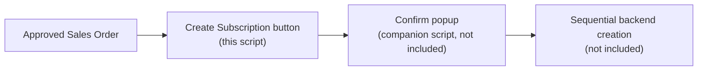

# NetSuite Workflow Helpers (SuiteScript 2.1)

**Author:** Daksh Chauhan

Two small User Event scripts that add one-click action buttons to existing records.

## 1. Create Subscription button (`UE_Create_Subscription_Button.js`)

Adds a **Create Subscription** button on Sales Orders that are past approval, and
wires it to a companion client script. The confirmation popup and the backend
subscription creation/activation processing are separate components and are **not
included** in this sample. In the full workflow, confirming the popup triggers
sequential backend creation of subscriptions with monitoring and error recovery.

## 2. Resume button (`UE_Resume_Button.js`)

Adds a resume action button on candidate records in view mode, wired to the same
companion client script (not included).

> Both scripts reference `demo_show_popup_create_subscription_CS.js`, which is not
> part of this portfolio set. Treat these as code samples. Company-specific names
> are genericized.
